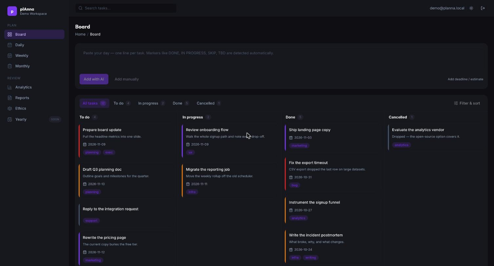
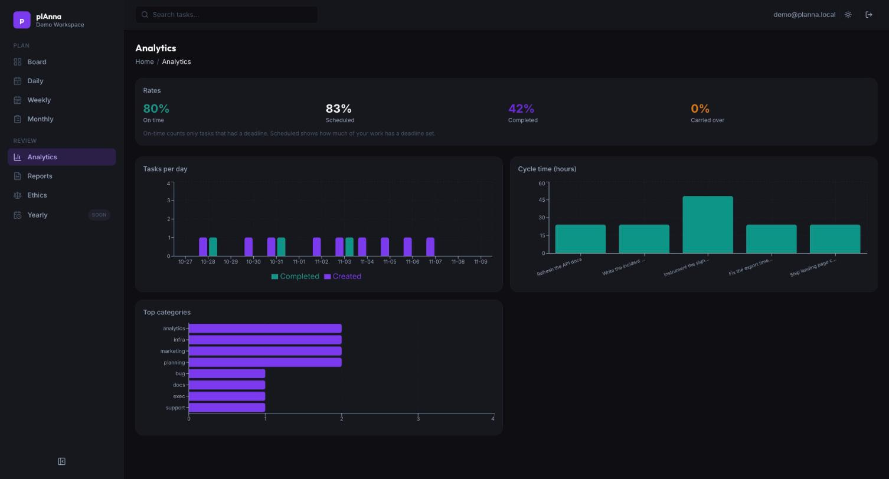
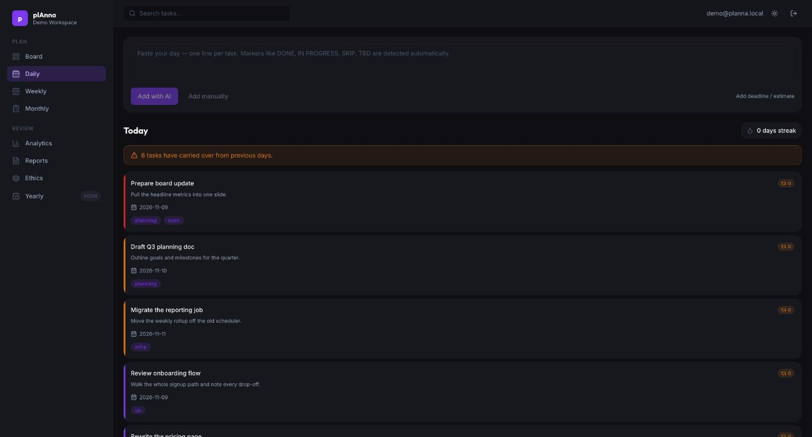
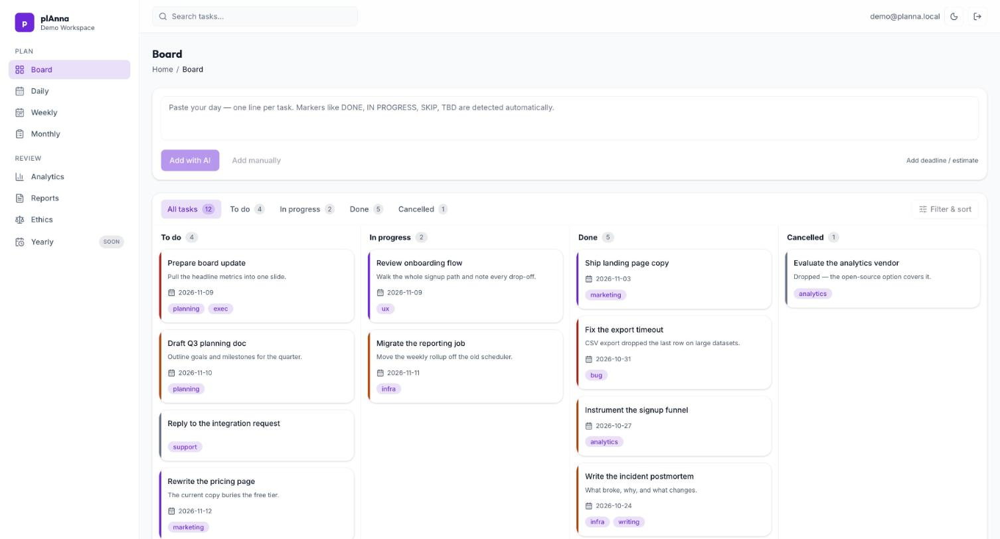

# plAnna

**A to-do list that talks back.** Write one sentence about your day, and plAnna turns it into a tracked board, then tells you where your time actually went.

[](https://github.com/oladannyel/planna/actions/workflows/ci.yml)
[](LICENSE)
[](https://nextjs.org)
[](https://www.typescriptlang.org)



---

## Why this exists

Most productivity tools make you do data entry before they give you anything back. plAnna inverts that: you write a sentence, it does the structuring, and the payoff is a record honest enough to judge your own performance against — which projects got your attention, which quietly starved, and what the fine detail of the work actually was.

It was built for one person's daily work across many parallel projects. It generalises to anyone who needs to track work daily and keep the details that usually get lost.

## What it does

| Capability                   | What it means in practice                                                                                                                                                                |
| ---------------------------- | ---------------------------------------------------------------------------------------------------------------------------------------------------------------------------------------- |
| **Natural-language capture** | Type _"ship the pricing API, review Tunde's PR, draft the Q3 deck"_ into a chat box. plAnna parses it into separate tasks with titles, priorities, tags, effort estimates and deadlines. |
| **Kanban board**             | Drag tasks across `todo → in progress → done`, with a `cancelled` lane and per-status archives.                                                                                          |
| **Daily & weekly planning**  | A daily focus view, a week planner, and automatic carry-over flagging so slipped work stays visible instead of vanishing.                                                                |
| **Analytics**                | Where time went by project and tag, attention distribution, and honest on-time completion rates measured against real deadlines.                                                         |
| **Monthly & AI reports**     | Generated narrative summaries of a period's work, built from your own task history.                                                                                                      |
| **Ethics check-in**          | A configurable reflection prompt set — the part of the tool that asks questions back.                                                                                                    |
| **Request links**            | A public `/request/[slug]` link so colleagues can file a task into your board without an account.                                                                                        |

## Screenshots

|                                                                                                                |                                                                                          |
| -------------------------------------------------------------------------------------------------------------- | ---------------------------------------------------------------------------------------- |
|                                                               |                                            |
| **Analytics** — on-time rate measured against real deadlines, throughput, cycle time and where attention went. | **Daily** — today's focus, with carry-over from previous days made impossible to ignore. |

Light theme, same board:



Every screenshot is the seeded demo workspace, which you get by running
`supabase db reset` — see [Quick start](#quick-start).

## Design system

plAnna is dark by default with a full light theme, both driven from one set of
tokens in [`tailwind.config.ts`](tailwind.config.ts) and
[`src/app/globals.css`](src/app/globals.css).

- **Semantic tokens** (`canvas`, `card`, `border`, `text-*`, accents) resolve
  through CSS custom properties, so a single utility class renders correctly in
  either theme. They hold raw RGB channels rather than hex, which is what keeps
  Tailwind's opacity modifiers (`bg-purple/15`) working.
- **No flash on load.** A small script in `<head>` applies the stored theme
  before first paint — React mounts too late to do this.
- **Contrast is tested, not eyeballed.** Every foreground/surface pair is
  asserted against WCAG AA in `src/lib/__tests__/contrast.test.ts`, in both
  themes. A token change that drops below 4.5:1 fails the suite.
- **Charts read the same tokens.** Recharts takes colours as props and cannot
  see Tailwind classes, so `useChartPalette()` reads the live custom properties
  instead of duplicating the palette as hex.

## Tech stack

- **[Next.js 16](https://nextjs.org)** (App Router, Server Actions, React Server Components, Turbopack)
- **TypeScript** in strict mode
- **[Supabase](https://supabase.com)** — Postgres, Auth (Google OAuth), and Row Level Security on every table
- **[Tailwind CSS](https://tailwindcss.com)** + **[Radix UI](https://www.radix-ui.com)** primitives
- **Any OpenAI-compatible model provider** for language-model calls — [OpenRouter](https://openrouter.ai) free tier by default
- **[Vitest](https://vitest.dev)** + Testing Library + MSW — 483 tests
- **[Recharts](https://recharts.org)** for analytics, **[dnd-kit](https://dndkit.com)** for the board

## Quick start

### Prerequisites

- **Node.js 22.22.2+** (developed on 24 LTS). The test toolchain sets the floor — jsdom 31 is the strictest at `^22.22.2`, with Vitest 5 and MSW 3 just behind it — and Node 20 reached end of life in April 2026.
- **pnpm 9+** — `npm i -g pnpm`
- A free **[Supabase](https://supabase.com)** project
- An API key for any OpenAI-compatible model provider — a free **[OpenRouter](https://openrouter.ai)** key is the default, and costs nothing

### 1. Clone and install

```bash
git clone https://github.com/oladannyel/planna.git
cd planna
pnpm install
```

### 2. Configure environment

```bash
cp .env.local.example .env.local
```

Fill in the values — see [`.env.local.example`](.env.local.example) for where each one comes from.

### 3. Set up the database

Run the migrations in [`supabase/migrations/`](supabase/migrations) **in order** against your Supabase project, either through the Supabase SQL editor or the Supabase CLI:

```bash
supabase db push
```

They create the schema, enable Row Level Security, and add the monthly-summary, ethics and deadline features.

### 4. Enable Google OAuth

In your Supabase dashboard, under **Authentication → Providers → Google**, enable the provider and add your redirect URL:

```
http://localhost:3000/auth/callback
```

### 5. Run it

```bash
pnpm dev
```

Open <http://localhost:3000>.

## Development

| Command           | What it does                    |
| ----------------- | ------------------------------- |
| `pnpm dev`        | Start the dev server            |
| `pnpm build`      | Production build                |
| `pnpm typecheck`  | `tsc --noEmit`, strict          |
| `pnpm lint`       | ESLint, zero warnings tolerated |
| `pnpm test`       | Full suite with coverage        |
| `pnpm test:watch` | Tests in watch mode             |
| `pnpm format`     | Prettier across the repo        |

### Local Supabase

`supabase start` brings up Postgres, Auth, Studio and a mail catcher locally,
applies every migration and seeds a demo workspace — no hosted project and no
egress limits needed:

```bash
supabase start          # first run pulls container images
supabase db reset       # replay migrations + seed
```

It runs on `544xx` ports rather than Supabase's `543xx` defaults, so it
coexists with other local Supabase projects. Sign in as `demo@planna.local`
and collect the magic link from the mail catcher at <http://127.0.0.1:54424>.

All four gates — typecheck, lint, test, build — must pass before anything merges. A Husky pre-commit hook runs lint-staged locally, and [CI](.github/workflows/ci.yml) enforces the same on every push and pull request.

## Project structure

```
src/
├── app/                  # Next.js App Router
│   ├── (auth)/           # Login
│   ├── (dashboard)/      # Board, daily, weekly, analytics, monthly, reports, ethics
│   ├── api/              # Route handlers
│   ├── auth/             # OAuth callback and signout
│   └── request/[slug]/   # Public task-request links
├── components/           # ui/ primitives, layout/, shared/
├── features/             # Vertical slices, one folder per domain
│   ├── tasks/            # Capture, parsing, task CRUD
│   ├── board/            # Kanban
│   ├── daily/ weekly/    # Planning views
│   ├── analytics/        # Metrics and charts
│   ├── monthly/ reports/ # Generated summaries
│   ├── ethics/           # Reflection check-ins
│   ├── request/          # Inbound request links
│   └── workspace/        # Workspace and slug handling
├── hooks/                # Shared React hooks
├── lib/                  # env, logger, result, date, cn, supabase clients
└── types/                # Shared types
supabase/migrations/      # Ordered SQL migrations
```

Each `features/*` folder follows the same shape: `schema.ts` (Zod), `queries.ts` (reads), `actions.ts` (Server Actions), `mappers.ts` (DB ↔ domain), components, and `__tests__/`.

## Architecture notes

- **Server Actions over API routes.** Mutations are Server Actions, validated with Zod at the boundary. The only route handler is the public request endpoint.
- **Results, not thrown errors.** Fallible operations return a `Result` type (`src/lib/result.ts`) so failure is part of the signature.
- **Security in the database.** Row Level Security policies in [`0002_rls_policies.sql`](supabase/migrations/0002_rls_policies.sql) are the authority on who can read what — the app layer is not the only gate.
- **The one unauthenticated path is capped.** Request links let anyone holding a slug file a task, which also spends a model call. Each workspace accepts 20 request-link submissions per hour, checked _before_ the model call so the expensive half of an abuse attempt never runs.
- **Validated environment.** `src/lib/env.ts` parses every variable through Zod at startup, so a misconfiguration fails loudly and immediately.
- **No model or provider lock-in.** plAnna talks plain OpenAI-compatible chat completions and uses no vendor-specific feature — no JSON mode, no tool calling, no structured outputs. The task parser asks for JSON in the prompt and tolerates a model that wraps it in a code fence or omits null keys, so small free models work. Point `AI_BASE_URL` at OpenRouter, OpenAI, Groq, Together, Fireworks, or a local Ollama / vLLM server, and set `AI_MODEL`. See [Swapping the model or provider](#swapping-the-model-or-provider).
- **The AI configuration is watched, and routes around itself.** A daily cron (`/api/cron/ai-health`) probes the key and every configured model, because free models are retired without notice and a revoked key looks exactly like a bad prompt from inside the app. Set `AI_MODEL_FALLBACKS` and a retired or rate-limited model is failed over per request, with no redeploy — see [Surviving a dead model](#surviving-a-dead-model).

## Swapping the model or provider

plAnna is not tied to a model or a vendor. Five variables decide everything:

| Variable             | What it does                                        |
| -------------------- | --------------------------------------------------- |
| `AI_BASE_URL`        | Any OpenAI-compatible `/chat/completions` endpoint  |
| `AI_API_KEY`         | That provider's key                                 |
| `AI_MODEL`           | The model that parses your notes into tasks         |
| `AI_REPORT_MODEL`    | The model that writes weekly and monthly narratives |
| `AI_MODEL_FALLBACKS` | Optional. Comma-separated models to fail over to    |

```bash
# OpenRouter free tier (the default — costs nothing)
AI_BASE_URL=https://openrouter.ai/api/v1
AI_MODEL=openrouter/free

# OpenAI
AI_BASE_URL=https://api.openai.com/v1
AI_MODEL=gpt-4o-mini

# Groq
AI_BASE_URL=https://api.groq.com/openai/v1
AI_MODEL=llama-3.3-70b-versatile

# Local Ollama — no key leaves your machine
AI_BASE_URL=http://localhost:11434/v1
AI_API_KEY=ollama
AI_MODEL=llama3.1
```

### Surviving a dead model

Free-tier models are retired without notice, and their request caps are per-model. A single slug in `AI_MODEL` is therefore a single point of failure that reaches the user as a note that will not parse.

`AI_MODEL_FALLBACKS` is a comma-separated chain tried in order:

```bash
AI_MODEL=openrouter/free
AI_MODEL_FALLBACKS=first-fallback,second-fallback
```

Deliberately no example slugs: free models are retired weekly, and the two this
file used to name were both dead 404s within a month of being written. List what
is live, then let the health check confirm your chain:

```bash
# what your provider currently serves for free
curl -s https://openrouter.ai/api/v1/models \
  | jq -r '.data[] | select(.pricing.prompt == "0") | .id'

# whether the chain you chose actually answers
curl -H "Authorization: Bearer $CRON_SECRET" localhost:3000/api/cron/ai-health
```

Failover is deliberately narrow — only failures a _different model_ could fix:

| Upstream response        | What happens                                       |
| ------------------------ | -------------------------------------------------- |
| 404 model retired        | Next model in the chain                            |
| 429 daily cap reached    | Next model in the chain — caps are per-model       |
| 408 / 5xx backend unwell | Next model in the chain                            |
| 401 / 403 key rejected   | Fails immediately — every model shares the one key |
| 400 malformed request    | Fails immediately — it will be malformed next time |

This happens per request, in `src/lib/ai-completion.ts`, and needs no redeploy. It is also why the daily health check only _reports_ a dead model rather than rewriting your configuration: a cron that redeploys production unattended at 03:00 is a worse failure than the one it is fixing. The check probes the fallbacks too, since those are precisely the models nobody notices breaking.

A provider that is **not** OpenAI-compatible — Anthropic's native API, Bedrock, Vertex — needs a gateway in front of it. Anything that speaks the OpenAI protocol works as-is.

These were once named `OPENROUTER_*`. Those names still work, so upgrading breaks nothing, but the neutral ones are the documented set.

## Deployment

Deploys to [Vercel](https://vercel.com) with no extra configuration. Set the same environment variables in your project settings, and point `NEXT_PUBLIC_APP_URL` and your Supabase OAuth redirect at the deployed domain.

## Contributing

Contributions are welcome. Start with [CONTRIBUTING.md](CONTRIBUTING.md) for the workflow and the quality gates. By participating you agree to the [Code of Conduct](CODE_OF_CONDUCT.md).

To report a security issue, please follow [SECURITY.md](SECURITY.md) rather than opening a public issue.

## License

[MIT](LICENSE) © Daniel Olaniyan — use it, fork it, change it to fit how you work.

plAnna's design system is adapted from [TailAdmin](https://github.com/TailAdmin/free-nextjs-admin-dashboard) (MIT, © 2023 TailAdmin). See [THIRD_PARTY_NOTICES.md](THIRD_PARTY_NOTICES.md).
